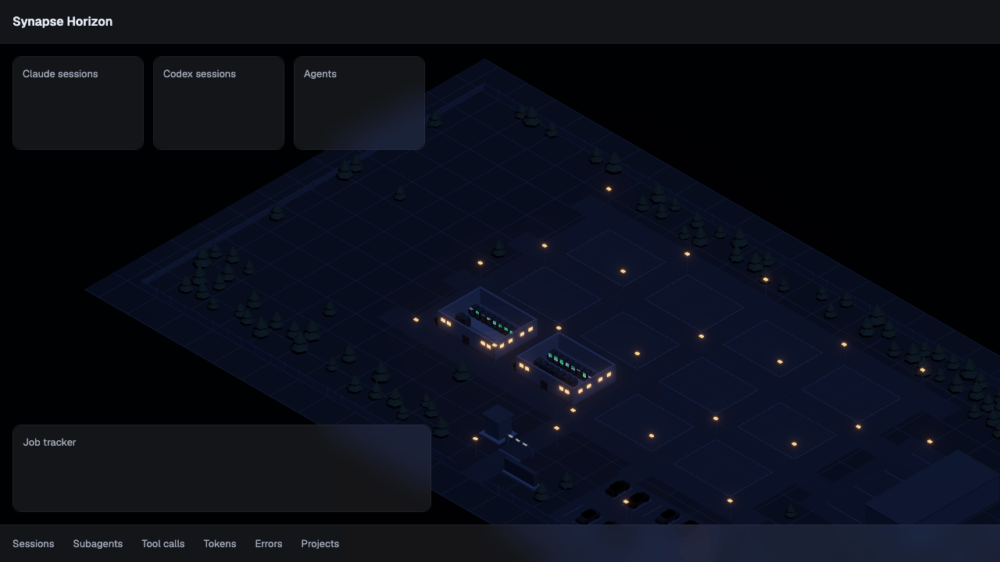
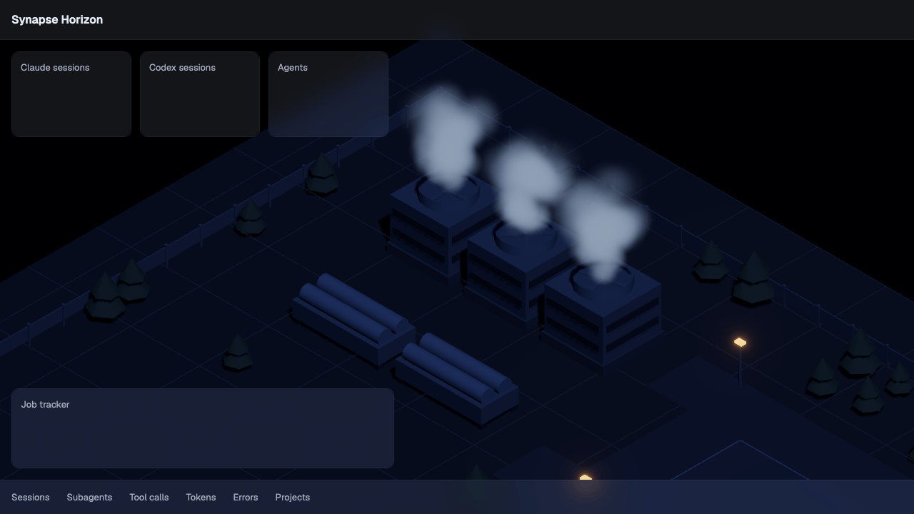
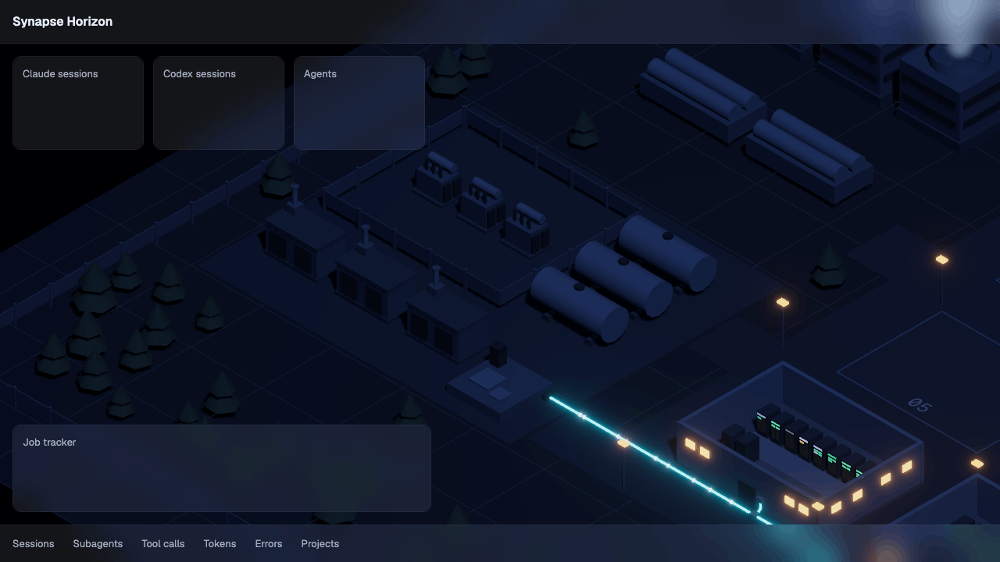
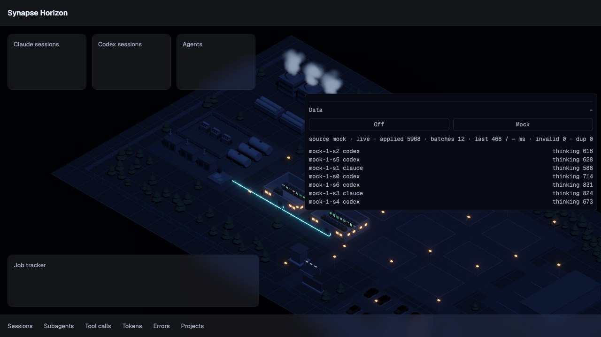

# Synapse Horizon

[](https://github.com/bjorkgard/ai-center/releases)



A live 3D AI data-centre dashboard that tracks Claude and Codex agents and subagents, styled like a strategy game.

## World

The campus, built in code from pure layouts and closed-form fake signals, chunk by chunk:





## Development setup

Install Vite+ (`vp`); it installs the Node version pinned in `.node-version`. Then:

```sh
vp install
vp dev
```

`vp dev` serves the app on `http://localhost:5173`.

## Testing and screenshots

```sh
vp exec playwright install chromium firefox webkit   # once per machine
vp run e2e         # smoke tests in Chromium and Firefox (what CI runs)
vp run e2e:local   # all three engines, then regenerates the screenshots
vp run shots       # builds, then writes docs/img/*.png (1280x720, under 200 KB)
```

The smoke spec waits for the scene's ready signal, then checks the page title, the canvas, the `app-version` meta tag and that
the console stays clean. A repeat-run spec captures the same view twice and asserts the two
images agree within a 0.5% pixel diff. The scene specs cover the draw-call bar, the 30 fps
calm mode, reduced motion, the projection toggle, the WebGL card, context loss and restore,
and the scene-error card. `vp run shots` waits on the ready signal for every image and fails
with `ShotFailed` (exit 1) if a page logs a console error or an image is over 200 KB.

## Scene core (chunk 04a)

One persistent 3D canvas fills the viewport behind the DOM overlay layer. It shows the campus (chunk 08), drawn through an orthographic isometric camera that the perf HUD can switch to perspective. Add `?dev=1` to show the perf HUD (fps, scene and post-processing draw calls, triangles, `renderer.info` counts, frame cap and mode, quality tier, WebGL state) and the `window.__sceneDev` hooks. `?webgl=0` forces the WebGL card, `?calm=0` keeps the 60 fps cap and `?freeze=1` renders one fixed frame.


## UI shell (chunk 04b)

The empty dashboard frame sits above the scene: top bar, KPI tiles, job tracker, tab strip and a right panel that `?dev=1` toggles from the HUD, all on `GlassPanel` (8% white tint over an adaptive dark layer, 16 px blur, solid fallback under slow frames). The store `safeArea` is the canvas minus the visible panels. A loader covers the 3D area until the first frame, and a toast host announces "Restoring 3D view" and "3D view restored".


## Look (chunk 04c)

A low-poly isometric campus in dark slate and concrete, lit by cool moonlight with warm window and LED points and glowing cyan fibre under bloom, matching the approved mockup ([docs/designs/variant-B-2.png](docs/designs/variant-B-2.png)). One shared material library and one light rig serve every view; `?view=lookdev` draws the fixed vignette that a committed baseline guards in `vp run e2e:local`.


## Hall (chunk 06)

One data hall built in code: floor slab, walls, a cutaway roof, cold and hot aisle tiles, a door as one merged mesh on a shared vertex-coloured material, and the windows as a second mesh on the shared window glow, with a sign panel above the door that reads the hall letter and project name from one shared canvas atlas. The roof is one clipping plane, cut away in every view; the sign fades out over 200 ms when it faces away or its project name drops under 12 px. `?view=hall` frames one hall; `?dev=1` adds a collapsed Hall section with the roof toggle (`__sceneDev.setRoofCut(on)`). The hall costs 4 scene draw calls (3 main pass, 1 shadow).


## Racks (chunk 07)

Each hall owns one rack InstancedMesh (16 bodies) and one LED InstancedMesh (208 LEDs: a status strip and 12 blades per rack), allocated once, so changing the rack count writes only the instance count and colour buffers and never adds a draw call or a geometry. LED colours are the D17 status colours; they pulse between 0.6 and 1.0 of their level over 1.2-3.0 s, and hold a steady 0.8 under reduced motion. Racks take slots through a pure allocator (a key keeps its slot, a new key takes the lowest free one, a 17th is counted). The seeded fake load (`src/scene/fake.ts`, read only through `SceneSignals`) gives the strips a 60/25/10/5 tool, thinking, idle, waiting mix and 0-6 lit blades. `?view=racks` shows the hall with a fixed 16 racks; `?dev=1` adds a collapsed Racks section (hall picker, count slider 0-16, fake load toggle) with `__sceneDev.setRackCount(hall, n)` and `__sceneDev.setFakeLoad(on)`.


## Campus (chunk 08)

The static campus around the halls, from a pure layout (`src/scene/campus/layout.ts`): 12 hall slots on a 4 x 3 grid (A and B in the front row nearest the gate, filling toward the back), the road grid, and zones for the cooling plant, power yard, gate, parking and loading dock. Halls A and B stand with the seeded fake racks; every other slot shows an empty pad with its number `01`-`12`, which appears once it measures 12 px. The site has roads, a parking lot with instanced parked cars (three dark greys, lights off), a security gate with a barrier boom, a loading dock with bay doors, instanced road lamps on the warm glow, trees, a perimeter fence open at the gate and a gate monument reading SYNAPSE HORIZON. The camera bounds, the ground, its grid and the shadow camera all come from the campus extent, and the first view and `0` frame the placed halls plus the plant, power and gate zones. The whole home view costs 38 scene draw calls with shadows on (27 for the campus, 6 for the cooling plant of chunk 09, 5 for the power yard and fibre of chunk 10). `?dev=1` adds a collapsed Campus section (placed halls 2-12, waypoint graph toggle) with `__sceneDev.setPlacedHalls(n)` and `__sceneDev.setWaypoints(on)`.


## Cooling (chunk 09)

The cooling plant stands in the plant zone at the top left of the home view: three low-poly cooling towers with an open fan stack each, two chillers, and a fan turning in every stack. Towers and chillers cast shadows. The vapour is up to 60 soft billboards per tower in one InstancedMesh (one draw call for the tower group), `#8090A8` at opacity 0.35 under normal alpha blending with no depth write, ordered back to front against the camera each frame. Each billboard grows from 1.2 to 2.4 units over a 6 s life and rises 0.6 units a second; it fades in over 0.5 s and out over the last 1.5 s through the per-instance fade, so a rebirth never pops. Vapour is a closed form of scene time and seed (particle `i` has age `(t + offset) mod 6 s` and shows while `i < 60 x duty`), so every frozen shot has full plumes and a duty change reaches them as particles are reborn. Fans turn 0.5 times a second at duty 1 and a tenth of that at duty 0; with reduced motion the vapour is 30% and the fans a quarter of their speed. The duty, each particle's age and each fan's angle come from `SceneSignals` (`duty()`, `vapourPhase(i)`, `fanAngle(i)`), seeded in `src/scene/fake.ts`. `?view=cooling` frames the plant zone; `?dev=1` adds a collapsed Cooling section with a duty slider (it follows the live duty until you drag it) and `__sceneDev.setDuty(value)`.


## Power and network (chunk 10)

The power yard stands in the power zone, left of the gate: a fenced substation with three transformers, three generators with exhaust stacks, three fuel tanks lying on saddles and the fibre entry vault at the zone's east edge, on the axis of the road in front of the first hall row. Transformers, generators and tanks cast shadows; the whole yard is one merged mesh (2 scene draw calls). The fibre runs from the vault along the road grid (the first road row, then a column road, then the road in front of a hall's row) to each placed hall's door side, with rounded right-angle bends of radius 0.6, 0.4 in from the kerb and 0.03 above the road; the last 0.6 units climb the wall beside the door to a small entry box. Lines that start the same way share their tubes, with a grey junction box where they part. Only placed halls get a line (A and B always); the lines are rebuilt when the placed set changes and the old geometry is disposed. The fibre costs 3 draw calls: the tubes, the junction and entry boxes, and one InstancedMesh for every line's packets. Packets are pale cyan spheres (`#A5F3FC`, emissive 3.2, the top of the glow ladder) that move at 2.5 units a second, one a second per line by default and at most 12 on a line (never closer than 1.2): a line of length `L` holds `n` packets (`ceil(rate L / 2.5)`, capped at 12 and at `L / 1.2`) and packet `j` has travelled `2.5 t + j L / n` units, wrapped to the line, so they sit evenly over the whole line and every frozen shot has populated lines; with reduced motion they move at 25% of that and the spacing stays. The rate and the lines' travelled distance come from `SceneSignals` (`packetRate()`, `packetPhase(line, i, length, count)`, which places packet `i`), computed from scene time (plus an offset that keeps packets in place when reduced motion toggles) in `src/scene/fake.ts`. `?view=power` frames the power zone and the start of the road beyond its vault; `?dev=1` adds a collapsed Network section with a packet-rate slider and `__sceneDev.setPacketRate(perSecond)`, and the read-only `__sceneDev.fibreLines()` and `__sceneDev.packetSpeed()`.


## Data sources (chunk 11)

Agent activity lands in one store (`src/app/store/data.ts`) as batches of normalised events (`src/data/schema.ts`, zod 4 `zod/mini`). Every source implements `{ start, stop, onEvents, onStatus }`, delivers at most 500 events a batch and reports `catching_up`, `live`, `closed` or `error`. Each event is validated; invalid ones are dropped and counted, repeats are skipped by id, and per-session `lastSeen` and status follow the newest `ts`. Totals per project, session and subagent are authoritative; a 50,000-event ring buffer keeps only the recent timeline. Only the mock exists for now: `?source=mock&scenario=steady&seed=1` streams a seeded `steady` scenario (3 fictional projects under `/work/`, Claude and Codex, a few subagents) on a sim clock: the first 10 sim minutes arrive as catch-up, then it runs in real time; with `freeze=1` only the catch-up is sent. `?dev=1` adds a collapsed Data section with a source switch, a health row (applied, batches, last batch, invalid, duplicates), the 50 newest sessions and, under a clicked session, its last 20 events.

`vp run mock:dump -- --seed 1 --scenario steady --minutes 10 --out events.jsonl` writes the mock's events as JSONL, one per line.



## Controls

Left-drag pans, right-drag rotates, the scroll wheel zooms towards the cursor, and a double-click on empty ground (a road, a pad or open ground, not a hall) flies home; the camera stays inside the campus. With the 3D view focused (Tab, right after the top bar) the keys work too: arrows pan, `+`/`=` and `-` zoom, `Q`/`E` rotate 45 degrees, `0` or `Home` frames the placed campus, `P` switches orthographic and perspective. `?dev=1` adds a Camera section under the perf HUD with a glide test, the projection switch and the right-panel toggle.

## Known limits

- **"Your browser could not start 3D (WebGL)."** The browser could not create a WebGL2 context. Turn on hardware acceleration in the browser settings and reload; Safari has no such setting, so update the browser and system. The panels still work.
- **"The 3D view lost its graphics connection."** The graphics context was lost and did not come back within 10 s. Reload the page; if it comes back by itself later the card hides.
- **"The 3D view stopped after an error."** The scene threw an error. Reload to restart it, and report the `[scene]` lines in the browser console; "Copy error details" puts them on the clipboard with the app version.

## Architecture

How three.js is integrated into the app: React Three Fiber (R3F), chosen by ADR 0001 from 48 measured passes under a decision rule written before the runs. See [docs/adr/0001-render-integration.md](docs/adr/0001-render-integration.md).


## Contributing

Branches are `chunk/NN-slug`, with one pull request per chunk and a Conventional Commit title. See [CONTRIBUTING.md](CONTRIBUTING.md).

## Versioning and releases

`package.json` `version` is the single source of truth; the app exposes it as `<meta name="app-version">`. Every merge to `main` that changes behaviour (`feat:`, `fix:`) produces a tagged GitHub Release with generated notes and `CHANGELOG.md`; `docs:` and `chore:` do not. `feat:` bumps the minor version, `fix:` the patch, and only `feat!:` reaches 1.0.0. Preview the next release with `GITHUB_TOKEN=$(gh auth token) vp run release:dry`. Details in [CONTRIBUTING.md](CONTRIBUTING.md).

## Status

Chunk 10 (power yard, fibre and packets) built; the world gallery above shows chunks 06 to 10. See [CONTRIBUTING.md](CONTRIBUTING.md) and [docs/PLAN.md](docs/PLAN.md) for the build plan.
