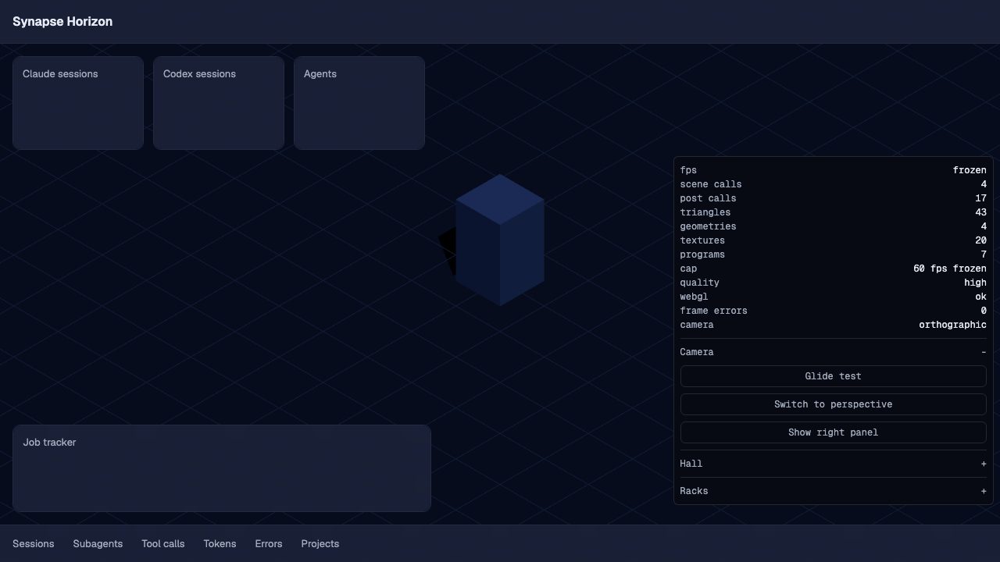
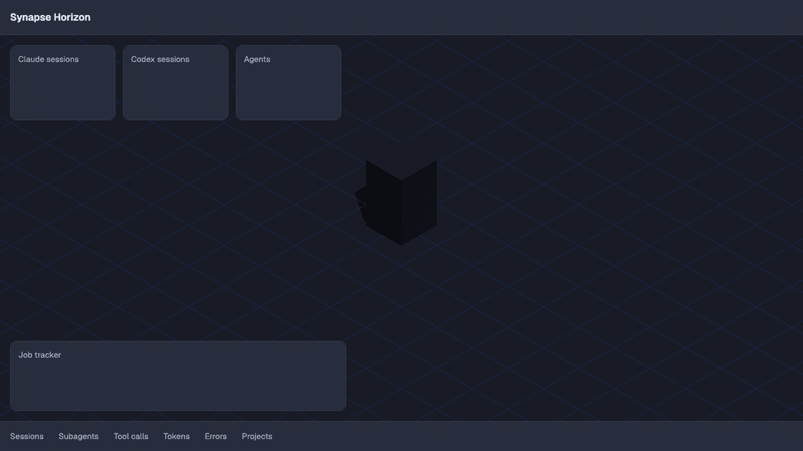
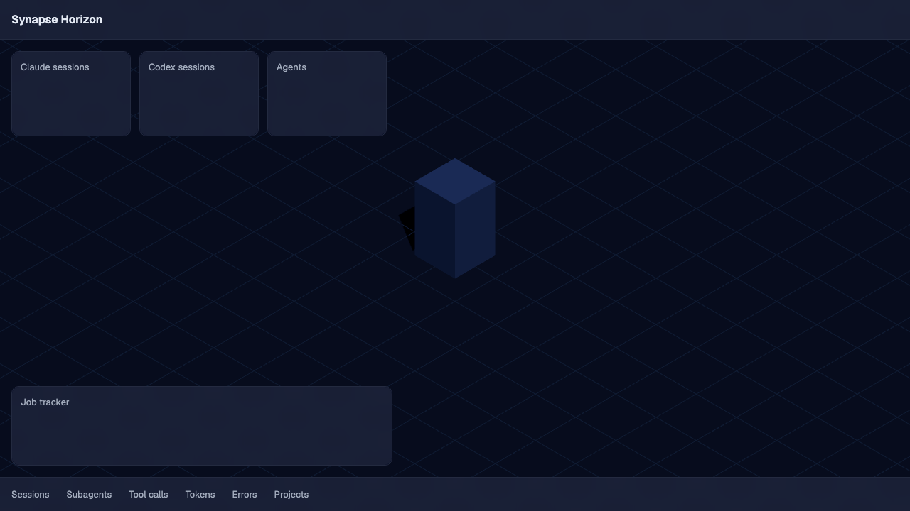
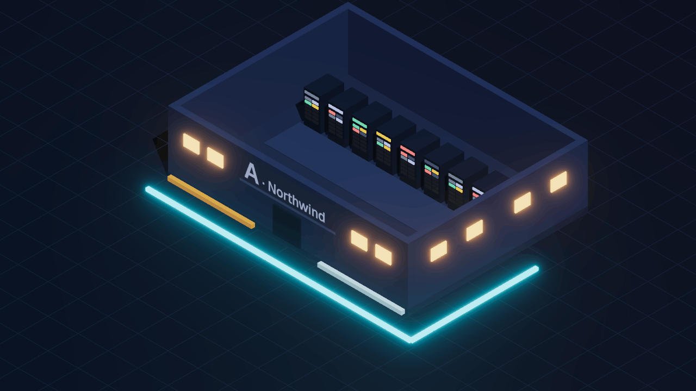
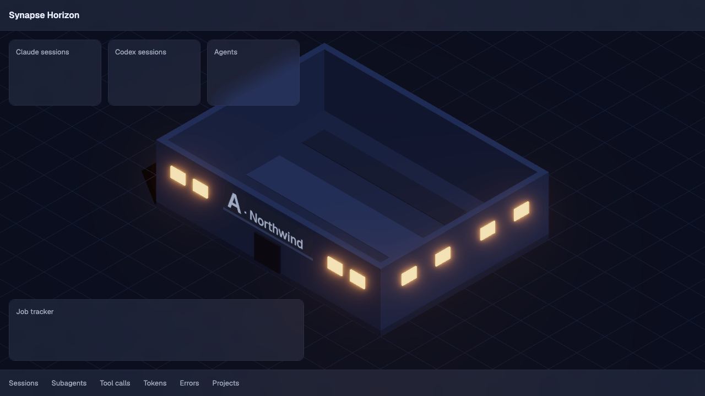
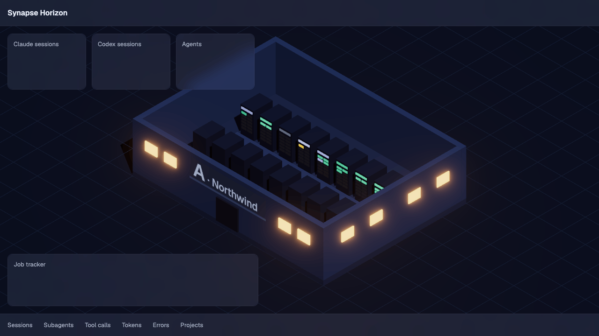

# Synapse Horizon

[](https://github.com/bjorkgard/ai-center/releases)


A live 3D AI data-centre dashboard that tracks Claude and Codex agents and subagents, styled like a strategy game.

## Development setup

Install Vite+ (`vp`); it installs the Node version pinned in `.node-version`. Then:

```sh
vp install
vp dev
```

`vp dev` serves the app on `http://localhost:5173`.

## Testing and screenshots

```sh
vp exec playwright install chromium firefox webkit   # once per machine
vp run e2e         # smoke tests in Chromium and Firefox (what CI runs)
vp run e2e:local   # all three engines, then regenerates the screenshots
vp run shots       # builds, then writes docs/img/*.png (1280x720, under 200 KB)
```

The smoke spec waits for the scene's ready signal, then checks the page title, the canvas, the `app-version` meta tag and that
the console stays clean. A repeat-run spec captures the same view twice and asserts the two
images agree within a 0.5% pixel diff. The scene specs cover the draw-call bar, the 30 fps
calm mode, reduced motion, the projection toggle, the WebGL card, context loss and restore,
and the scene-error card. `vp run shots` waits on the ready signal for every image and fails
with `ShotFailed` (exit 1) if a page logs a console error or an image is over 200 KB.

## Scene core (chunk 04a)

One persistent 3D canvas fills the viewport behind the DOM overlay layer. It shows a test cube on a ground plane, drawn through an orthographic isometric camera that the perf HUD can switch to perspective. Add `?dev=1` to show the perf HUD (fps, scene and post-processing draw calls, triangles, `renderer.info` counts, frame cap and mode, quality tier, WebGL state) and the `window.__sceneDev` hooks. `?webgl=0` forces the WebGL card, `?calm=0` keeps the 60 fps cap and `?freeze=1` renders one fixed frame.



## UI shell (chunk 04b)

The empty dashboard frame sits above the scene: top bar, KPI tiles, job tracker, tab strip and a right panel that `?dev=1` toggles from the HUD, all on `GlassPanel` (8% white tint over an adaptive dark layer, 16 px blur, solid fallback under slow frames). The store `safeArea` is the canvas minus the visible panels. A loader covers the 3D area until the first frame, and a toast host announces "Restoring 3D view" and "3D view restored".



## Look (chunk 04c)

A low-poly isometric campus in dark slate and concrete, lit by cool moonlight with warm window and LED points and glowing cyan fibre under bloom, matching the approved mockup ([docs/designs/variant-B-2.png](docs/designs/variant-B-2.png)). One shared material library and one light rig serve every view; `?view=lookdev` draws the fixed vignette that a committed baseline guards in `vp run e2e:local`.





## Hall (chunk 06)

One data hall built in code: floor slab, walls, a cutaway roof, cold and hot aisle tiles, a door as one merged mesh on a shared vertex-coloured material, and the windows as a second mesh on the shared window glow, with a sign panel above the door that reads the hall letter and project name from one shared canvas atlas. The roof is one clipping plane, cut away in every view; the sign fades out over 200 ms when it faces away or its project name drops under 12 px. `?view=hall` frames one hall; `?dev=1` adds a collapsed Hall section with the roof toggle (`__sceneDev.setRoofCut(on)`). The hall costs 4 scene draw calls (3 main pass, 1 shadow).



## Racks (chunk 07)

Each hall owns one rack InstancedMesh (16 bodies) and one LED InstancedMesh (208 LEDs: a status strip and 12 blades per rack), allocated once, so changing the rack count writes only the instance count and colour buffers and never adds a draw call or a geometry. LED colours are the D17 status colours; they pulse between 0.6 and 1.0 of their level over 1.2-3.0 s, and hold a steady 0.8 under reduced motion. Racks take slots through a pure allocator (a key keeps its slot, a new key takes the lowest free one, a 17th is counted). The seeded fake load (`src/scene/fake.ts`, read only through `SceneSignals`) gives the strips a 60/25/10/5 tool, thinking, idle, waiting mix and 0-6 lit blades. `?view=racks` shows the hall with a fixed 16 racks; `?dev=1` adds a collapsed Racks section (hall picker, count slider 0-16, fake load toggle) with `__sceneDev.setRackCount(hall, n)` and `__sceneDev.setFakeLoad(on)`.



## Controls

Left-drag pans, right-drag rotates, the scroll wheel zooms towards the cursor, and a double-click on empty ground flies home; the camera stays inside the campus. With the 3D view focused (Tab, right after the top bar) the keys work too: arrows pan, `+`/`=` and `-` zoom, `Q`/`E` rotate 45 degrees, `0` or `Home` returns home, `P` switches orthographic and perspective. `?dev=1` adds a Camera section under the perf HUD with a glide test, the projection switch and the right-panel toggle.

## Known limits

- **"Your browser could not start 3D (WebGL)."** The browser could not create a WebGL2 context. Turn on hardware acceleration in the browser settings and reload; Safari has no such setting, so update the browser and system. The panels still work.
- **"The 3D view lost its graphics connection."** The graphics context was lost and did not come back within 10 s. Reload the page; if it comes back by itself later the card hides.
- **"The 3D view stopped after an error."** The scene threw an error. Reload to restart it, and report the `[scene]` lines in the browser console; "Copy error details" puts them on the clipboard with the app version.

## Architecture

How three.js is integrated into the app: React Three Fiber (R3F), chosen by ADR 0001 from 48 measured passes under a decision rule written before the runs. See [docs/adr/0001-render-integration.md](docs/adr/0001-render-integration.md).


## Contributing

Branches are `chunk/NN-slug`, with one pull request per chunk and a Conventional Commit title. See [CONTRIBUTING.md](CONTRIBUTING.md).

## Versioning and releases

`package.json` `version` is the single source of truth; the app exposes it as `<meta name="app-version">`. Every merge to `main` that changes behaviour (`feat:`, `fix:`) produces a tagged GitHub Release with generated notes and `CHANGELOG.md`; `docs:` and `chore:` do not. `feat:` bumps the minor version, `fix:` the patch, and only `feat!:` reaches 1.0.0. Preview the next release with `GITHUB_TOKEN=$(gh auth token) vp run release:dry`. Details in [CONTRIBUTING.md](CONTRIBUTING.md).

## Status

Chunk 07 (instanced racks and LEDs) built. See [CONTRIBUTING.md](CONTRIBUTING.md) and [docs/PLAN.md](docs/PLAN.md) for the build plan.
