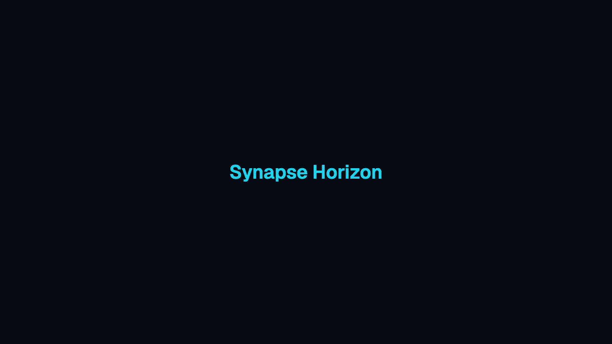
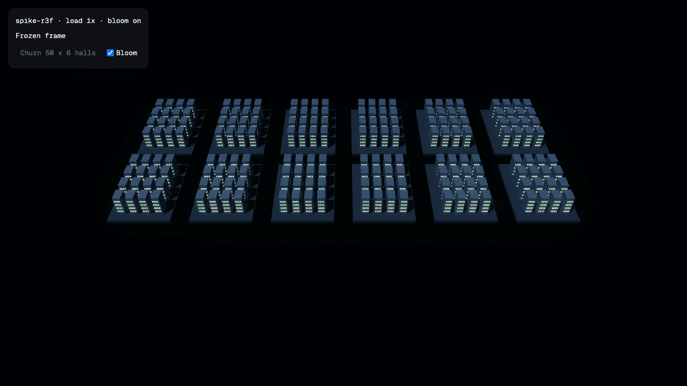

# Synapse Horizon

[](https://github.com/bjorkgard/ai-center/releases)



A live 3D AI data-centre dashboard that tracks Claude and Codex agents and subagents, styled like a strategy game.

## Development setup

Install Vite+ (`vp`); it installs the Node version pinned in `.node-version`. Then:

```sh
vp install
vp dev
```

`vp dev` serves the app on `http://localhost:5173`.

## Testing and screenshots

```sh
vp exec playwright install chromium firefox webkit   # once per machine
vp run e2e         # smoke tests in Chromium and Firefox (what CI runs)
vp run e2e:local   # all three engines, then regenerates the screenshots
vp run shots       # builds, then writes docs/img/*.png (1280x720, under 200 KB)
```

The smoke spec checks the page title, the heading, the `app-version` meta tag and that
the console stays clean. A repeat-run spec captures the same view twice and asserts the two
images agree within a 0.5% pixel diff. `vp run shots` fails with `ShotFailed` (exit 1) if a
page logs a console error or an image is over 200 KB.

The spike spec (`e2e/spike.spec.ts`) opens both render-spike views at 1x and 4x load and checks they draw the same scene. It runs under `vp run e2e:local` and is skipped when `CI` is set.

## Architecture

How three.js is integrated into the app: React Three Fiber (R3F), chosen by ADR 0001 from 48 measured passes under a decision rule written before the runs. See [docs/adr/0001-render-integration.md](docs/adr/0001-render-integration.md).



## Contributing

Branches are `chunk/NN-slug`, with one pull request per chunk and a Conventional Commit title. See [CONTRIBUTING.md](CONTRIBUTING.md).

## Versioning and releases

`package.json` `version` is the single source of truth; the app exposes it as `<meta name="app-version">`. Every merge to `main` that changes behaviour (`feat:`, `fix:`) produces a tagged GitHub Release with generated notes and `CHANGELOG.md`; `docs:` and `chore:` do not. `feat:` bumps the minor version, `fix:` the patch, and only `feat!:` reaches 1.0.0. Preview the next release with `GITHUB_TOKEN=$(gh auth token) vp run release:dry`. Details in [CONTRIBUTING.md](CONTRIBUTING.md).

## Status

Chunk 02b in progress. See [CONTRIBUTING.md](CONTRIBUTING.md) and [docs/PLAN.md](docs/PLAN.md) for the build plan.
